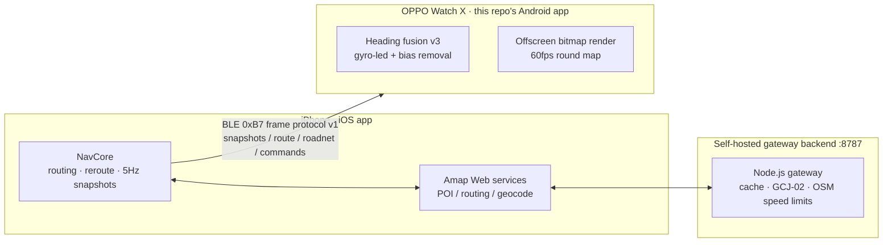

<div align="center">

# MOTO GPS · Watch X Port

**Handlebar navigation, now on your wrist.**

A port of [MOTO GPS · Waveshare Edition](https://github.com/mx3353672833-debug/moto-gps-waveshare):
the original Waveshare ESP32 round-display hardware → **OPPO Watch X (Android)**,
paired with the original iPhone app and a self-hosted routing gateway.

*Android watch app · enhanced iOS app · Node.js routing gateway*

</div>

---

> **Language:** English · [中文](README.md)

> ⚠️ **This repository is a derivative (fork) of the upstream project.**
> The original project was created by **Maler X** and is licensed under the
> **PolyForm Noncommercial 1.0.0** license (attribution · noncommercial).
> All changes in this repository follow the same license.
> Author's site: <https://maler.top/> · Upstream: <https://github.com/mx3353672833-debug/moto-gps-waveshare>

## What is this

A round AMOLED motorcycle navigator worn on the wrist.

Search a destination and compare routes on the iPhone; once navigation starts, the watch
connects over **BLE** and shows turn-by-turn guidance, distance, speed and speed limits,
with the map rotating around a fixed rider arrow. Swipe for the speed page and music
controls — no need to touch the phone with gloves on.

The upstream project requires a Waveshare ESP32-S3 dev board and custom firmware.
This port moves everything onto a **mass-produced OPPO Watch X (466×466 round AMOLED)** —
no soldering, no flashing.

## Architecture



## Watch app highlights

- **Offscreen bitmap rendering** — north-up base map cached in a bitmap; each frame is a
  single rotate + translate, 60fps with zero reprojection.
- **Heading fusion v3** — gyro-led integration, slow magnetometer correction, stillness
  gating and bias subtraction; no drift when resting flat.
- **Lifecycle screens** aligned with the upstream LVGL spec: CONNECT PHONE → CONNECTING →
  CONNECTED (breathing green check) → READY TO RIDE → BUILDING ROUTE (animated draw).
- **ViewPager-style page transitions** (drag-follow + decelerate settle), 3-page cycle:
  navigation → speed → music (launches the watch's system music controller).
- **Speed-limit badge** from OSM Overpass (GCJ-02 corrected, mode-filtered).
- **Honest display** — explicit pages for signal loss / no fix / no route; never fake data.

## Quick start

```bash
# Watch app (this repo's core deliverable)
cd platforms/android-watch
gradle assembleDebug        # JDK 17 + Android SDK
adb install -r app/build/outputs/apk/debug/app-debug.apk
adb shell dumpsys deviceidle whitelist +com.motogps.watch

# Routing gateway
cd backend && npm install && npm start   # listens on :8787
```

For the iPhone app, follow the upstream
[iOS sideload guide](docs/IOS_SIDELOAD.md) (SideStore, free Apple ID, 7-day renewal),
or let GitHub Actions (`ios-sideload.yml`) build an unsigned IPA automatically.

### 2b. Android phone app (no iPhone needed)

The upstream repo ships a native Android phone app (`platforms/android`, Kotlin + Compose):
destination search, route preview, BLE connection to the display, lock-screen foreground
navigation — sharing the same C++ nav core and protocol stack as iOS, with no Google Play
services dependency:

```bash
cd platforms/android
gradle assembleDebug   # JDK 17, Android SDK + NDK required (shared C++ via NDK)
```

> Upstream marks real-device pairing as still experimental; the combination with this
> repo's watch app is experimental too — issues with your device model are welcome.

Gateway configuration: [GATEWAY_SETUP.md](docs/GATEWAY_SETUP.md) (Amap key required).

## Differences from upstream

- New `platforms/android-watch`: native OPPO Watch X app (the core of this repo);
- Android phone app (`platforms/android`) verified to build in this fork and compatible
  with the watch app's BLE peripheral;
- iOS: pushes BUILDING ROUTE state as soon as route planning starts; allows LAN HTTP to
  the gateway; speed-limit passthrough;
- Gateway: search LRU cache (10 min TTL), OSM speed-limit pipeline;
- Watch protocol stack is fully compatible with upstream BLE v1
  (0xB7 frames, CRC-16/CCITT-FALSE, handshake/heartbeat/watchdog).

## License & attribution

Licensed under the upstream **PolyForm Noncommercial License 1.0.0**.
`LICENSE.md` and the required `NOTICE` lines are preserved:

```
Required Notice: Copyright (c) 2026 Maler X (https://github.com/mx3353672833-debug).
Required Notice: MOTO GPS - Waveshare Edition by Maler X. Source: https://github.com/mx3353672833-debug/moto-gps-waveshare
```

Personal use, study and noncommercial distribution are permitted; any commercial use is
not. Modified redistributions must keep the license and notice lines.

## Credits

- **[Maler X](https://github.com/mx3353672833-debug)** — creator of MOTO GPS. Protocol
  design, navigation core, iOS app and the whole product vision come from upstream;
  this repo merely stands on those shoulders.
- [Glimpse](https://maler.top/) · [Waveshare Electronics](https://www.waveshare.net/)
