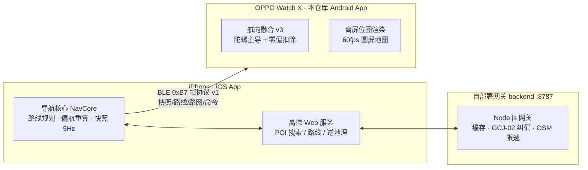

<div align="center">

# MOTO GPS · Watch X 移植版

**把车把圆屏导航，装进你的手腕。**

基于 [MOTO GPS · Waveshare Edition](https://github.com/mx3353672833-debug/moto-gps-waveshare) 的移植与增强：
原项目的微雪 ESP32 圆屏硬件 → **OPPO Watch X 安卓手表**，配合原版 iPhone App 与自部署路线网关。

*Android 手表 App · 改良版 iOS App · Node.js 路线网关*

</div>

---

> **语言 / Language:** 中文 · [English](README.en.md)

> ⚠️ **本仓库是上游项目的衍生版本（fork）。**
> 原项目由 **Maler X** 开发，采用 **PolyForm Noncommercial 1.0.0** 许可（署名 · 非商业使用）。
> 本仓库的全部修改同样遵循该许可。原作者主页：<https://maler.top/> · 上游仓库：<https://github.com/mx3353672833-debug/moto-gps-waveshare>

## 这是什么

一块戴在手腕上的圆屏 AMOLED 摩托车导航。

出发前在 iPhone 上搜索目的地、比较路线；开始导航后，手腕上的手表通过 **BLE 直连**显示
路口转向、距离、速度与限速牌，地图围绕固定的车头箭头旋转移动。滑动切换速度页与音乐控制，
无需停车摘手套操作手机。

原项目需要微雪 ESP32-S3 触屏开发板与自制固件；本移植版把这一切搬进了
**OPPO Watch X（466×466 圆形 AMOLED）**，一块现成的量产手表，无需任何焊接与烧录。

## 系统架构



- **iPhone**：定位、搜索、路线计算（复用上游 iOS App 与共享 C++ NavCore，本仓库小幅增强）；
- **网关**：Node.js 轻量代理，聚合高德能力，附加 OSM 限速牌数据与 LRU 搜索缓存；
- **手表**：本仓库重写的 Kotlin App，以 BLE GATT 外设角色与 iPhone 直连——
  不需要手机安卓 App，不需要 Google Play 服务。

## 手表端亮点

| 模块 | 说明 |
| --- | --- |
| 离屏位图渲染 | 底图+路线朝北渲染进缓存位图，每帧仅一次旋转+平移，圆屏地图 60fps 零重投影 |
| 航向融合 v3 | 陀螺仪积分主导 + 磁力计慢校准 + 静止判定 + 零偏扣除，平放静置不自转 |
| 生命周期页面 | 对齐上游 LVGL 规格：CONNECT PHONE → CONNECTING → CONNECTED（绿勾呼吸）→ READY TO RIDE → BUILDING ROUTE（路线描画动画） |
| 页面切换 | 拖拽跟手 + 二次缓出的双页滑动过渡（类系统 ViewPager 手感） |
| 三页循环 | 导航 → 速度 → 音乐；音乐页直接拉起手表系统音乐控制 |
| 限速牌 | 右上角圆牌常显，数据来自 OSM Overpass（GCJ-02 纠偏 + 众数过滤） |
| 诚实显示 | 信号丢失、无定位、无路线都有明确状态页，不显示假数据 |

## 快速开始

### 1. 手表 App（本仓库核心产出）

```bash
cd platforms/android-watch
gradle assembleDebug   # 需要 JDK 17 与 Android SDK
adb install -r app/build/outputs/apk/debug/app-debug.apk
```

任意 466×466 左右的圆形 AMOLED 安卓手表均可运行（Wear OS 3+ 或带蓝牙的 AOSP 手表）。
安装后建议把 App 加入电池优化白名单，保证后台 BLE 常连：

```bash
adb shell dumpsys deviceidle whitelist +com.motogps.watch
```

### 2. iPhone App

直接使用上游 [iOS 侧载教程](docs/IOS_SIDELOAD.md)（SideStore 免签名安装，免费 Apple ID 7 天续签），
或 fork 本仓库后由 GitHub Actions（`ios-sideload.yml`）自动构建未签名 IPA。

### 2b. 安卓手机 App（无需 iPhone）

上游已包含原生安卓手机 App（`platforms/android`，Kotlin + Compose）——搜索目的地、
路线预览、BLE 连接圆屏、锁屏前台导航，与 iOS 共用同一套 C++ 导航核心与协议栈，
不依赖 Google Play 服务：

```bash
cd platforms/android
gradle assembleDebug   # 需要 JDK 17、Android SDK 与 NDK（shared C++ 经 NDK 编译）
```

- 配对：首次连接手表会弹系统配对框（LE Just Works），点「配对」即可；
- 定位使用系统 GPS（WGS84），无 GMS 的国产手机可用；
- 音乐控制走系统媒体会话（网易云 / QQ 音乐 / Spotify 等均可），需授予「通知使用权」；
- 网关地址在 App 内设置，同一局域网下直连延迟最低。

> 注：上游标注「真机配对与骑行仍在验证中」，与本仓库手表 App 的组合同样处于实验阶段，
> 欢迎提 Issue 反馈机型与现象。

### 3. 路线网关

```bash
cd backend
npm install && npm start   # 监听 :8787
```

网关需要高德开放平台 Key，配置与内网穿透见 [网关配置指南](docs/GATEWAY_SETUP.md)。
iOS App 填入网关地址即可（同一局域网下走 HTTP 直连，延迟毫秒级）。

## 与上游的主要差异

- 新增 `platforms/android-watch`：OPPO Watch X 原生 App（本项目全部核心工作）；
- iOS 端：规划阶段即向手表推送 BUILDING ROUTE 状态；允许局域网 HTTP 直连网关；限速牌透传；
- 网关：搜索 LRU 缓存（TTL 10min）、OSM 限速牌管道、能力位如实上报；
- 手表端协议栈与上游 BLE v1 完全兼容（0xB7 帧、CRC-16/CCITT-FALSE、握手/心跳/看门狗）。

协议与上游设计文档仍然适用：[BLE 导航协议 v1](shared/protocol/ble-navigation-v1.md) ·
[原型规格](docs/WAVESHARE_IOS_PROTOTYPE.md) · [用户手册](docs/USER_MANUAL.md)

## 使用许可与署名

本项目基于上游项目修改，沿用 **PolyForm Noncommercial License 1.0.0**（非商业 · 署名）。
`LICENSE.md` 与上游要求的 `NOTICE` 声明完整保留：

```
Required Notice: Copyright (c) 2026 Maler X (https://github.com/mx3353672833-debug).
Required Notice: MOTO GPS - Waveshare Edition by Maler X. Source: https://github.com/mx3353672833-debug/moto-gps-waveshare
```

- ✅ 允许：个人使用、学习研究、自己编译改装、（修改后的）非商业分发
- ❌ 禁止：任何商业用途（销售、收费集成、商业产品内置等）
- 修改与再分发必须同样保留许可与上述署名声明

## 致谢

- **[Maler X](https://github.com/mx3353672833-debug)** —— MOTO GPS 原作者。协议设计、
  导航核心、iOS App 与整条产品思路全部来自上游项目，本仓库只是站在它的肩膀上。
- [Glimpse](https://maler.top/) · [Waveshare Electronics](https://www.waveshare.net/)
